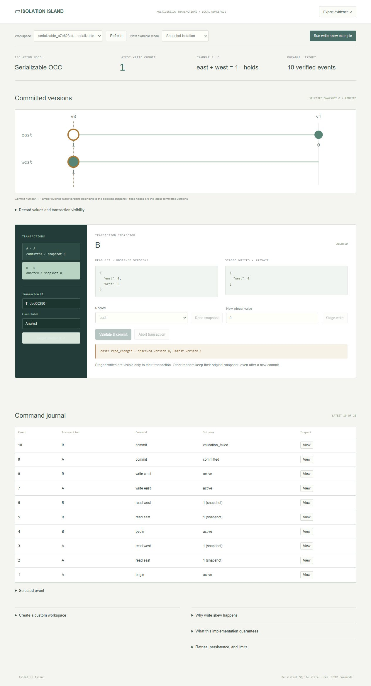

# Isolation Island

A durable MVCC transaction workbench: reproduce write skew under snapshot isolation, then prevent it with conservative optimistic read-set validation.



The commit-version diagram shows durable values on aligned record lanes. Green filled nodes mark the latest committed versions; amber outlines identify the committed versions visible to the selected transaction snapshot. Private staged writes remain in the inspector. The diagram fades on changed version/snapshot data and respects reduced motion; narrow screens scroll it internally.

## Run

Requires Python 3.10+; no runtime packages or external services.

```sh
python run.py --port 8000
```

Open http://127.0.0.1:8000. SQLite state lives in ignored `data/island.sqlite3`; `--data PATH` selects another database. Node 22+ is used only for the JavaScript syntax check.

## Try it

1. Run the write-skew example in Snapshot isolation mode. Both transactions read east = west = 1, write different keys, and commit. The rule east + west >= 1 is violated.
2. Switch the new-example mode to Serializable validation and run again. The second commit aborts because its observed east version changed; the rule holds.
3. Begin your own transaction, read a record, stage writes, and commit or abort. Inspect historical versions, private writes, read sets, and the command journal.
4. Export evidence containing the seed, full state, canonical event payloads, and chained SHA-256 digests. Reloading preserves transactions, including active ones.

## Implementation

`store.py` separates deterministic state transitions from SQLite persistence. Each logical transaction captures a commit-head snapshot; reads select the newest record version at or before that head, while staged writes take precedence. A successful multi-key write commit increments the head once and publishes all values at that version.

Snapshot mode rejects writes whose latest committed version exceeds the transaction snapshot. Serializable mode also validates every recorded base read against its latest version. Version comparison catches changes even when a value changes back. This is conservative optimistic validation in commit order, **not PostgreSQL SSI**. Read-only stale transactions can be rejected. The model has fixed keys and point reads; no inserts, deletes, predicates, or range-read phantom handling.

Each command uses a short SQLite `BEGIN IMMEDIATE` transaction to atomically update the state projection and append its event. Logical transactions span HTTP requests without holding SQLite transactions open. Reads replay the journal and verify hashes, results, and the projection. SQL triggers prevent ordinary event mutation; a database owner can rewrite data and hashes, so the journal is not an authenticity guarantee.

Transaction IDs are reusable only as retries with the same client label. Repeating a terminal commit or abort returns its original outcome without publishing duplicate versions. Every accepted command attempt still appends an event. Invalid requests do not. Aborted staged writes remain visible for diagnosis but never enter committed versions.

## HTTP surface

| Method and path                    | Behavior                                                      |
| ---------------------------------- | ------------------------------------------------------------- |
| GET /api/workspaces                | List existing workspaces                                      |
| POST /api/workspaces               | Create `{id, mode, records}`; identical existing seed replays |
| GET /api/workspaces/{id}           | Audited seed, projection, and event history                   |
| POST /api/workspaces/{id}/commands | Begin, read, write, commit, or abort                          |

Commands use `{action, tx}` plus `client` for begin, `key` for read/write, and integer `value` for write. Validation aborts return HTTP 409 with the recorded event; malformed requests return 400. Client labels are not authentication. The server binds loopback, validates Host/Origin, serves a fixed static allowlist, and limits JSON bodies to 16 KiB.

Bounds: 20 workspaces; 1–12 fixed records with values from -1,000,000 to 1,000,000; 100 total and 12 active transactions per workspace; 500 journal events per workspace. Histories and versions are retained without garbage collection. This is a bounded teaching engine, not a production database or a simulator of SQLite's own isolation levels.

## Verification

```sh
python -m unittest discover -s tests -v
npm run check
```

Ten tests cover write skew in both modes, repeatable reads and private writes across restart, ten competing same-key writers with one winner, multi-key atomicity, terminal retries, read-only and ABA validation, SQL-failure rollback, immutable history and tampering, fixed-key validation, and real HTTP responses. CI runs Python 3.11/3.13 on Linux and Windows.

Browser checks exercised both guided histories, manual staged reads, abort, export, and reload. Independent Python replay verified every event, state hash, chain link, and final projection in the committed [snapshot example](docs/snapshot.json) and [serializable example](docs/serializable.json). These contain fictional two-replica records.

## Background

- [PostgreSQL transaction isolation](https://www.postgresql.org/docs/18/transaction-iso.html) describes snapshot anomalies and serializable behavior.
- [Kung and Robinson: On Optimistic Methods for Concurrency Control](https://people.csail.mit.edu/tdanford/6830papers/kung-optimistic-methods.pdf) provides background on optimistic validation.
- [PostgreSQL SSI](https://wiki.postgresql.org/wiki/SSI) explains a different serializable implementation; this project does not implement it.
